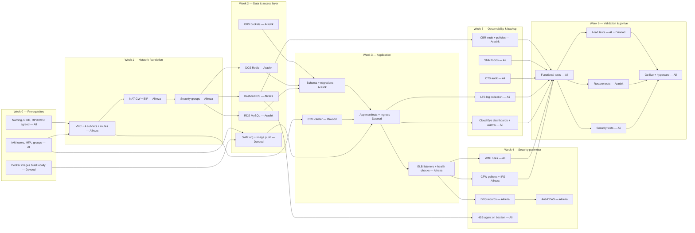

# 01 — Roadmap (6 weeks)

Each week ends with a **milestone gate**: the deliverable is demonstrated in the weekly sync before the next week starts. Task IDs (e.g. `AR-2`) refer to the per-person task files in `tasks/`.

## Dependency graph

## Week-by-week

### Week 0 — Prerequisites (all)
- Complete every checkbox in `00-prerequisites.md`.
- **Milestone M0**: all four members log in with personal MFA-protected IAM users; Docker images build locally; naming and CIDR plan signed off.

### Week 1 — Network foundation (Alireza leads, Ali supports on IAM)
| Task | Owner | Depends on |
|---|---|---|
| AR-1 VPC + 4 subnets + route tables | Alireza | M0 |
| AR-2 NAT Gateway + EIP | Alireza | AR-1 |
| AR-3 Security groups (ELB/CCE/RDS/DCS/bastion) | Alireza | AR-1 |
| AL-1..AL-3 IAM hardening finished (if not done in W0) | Ali | — |
- **Milestone M1**: VPC reachable, subnets and SGs exist with convention names/tags; a test ECS in the CCE subnet reaches the internet via NAT.

### Week 2 — Data & access layer (Arashk leads, Alireza + Davood in parallel)
| Task | Owner | Depends on |
|---|---|---|
| AK-1 RDS MySQL instance | Arashk | AR-3 |
| AK-2 DCS Redis instance | Arashk | AR-3 |
| AK-3 OBS buckets + policies + versioning | Arashk | M0 |
| AR-4 Bastion ECS host | Alireza | AR-3 |
| DA-1 SWR organization, push all images | Davood | M0 |
- **Milestone M2**: from the bastion, `mysql` and `redis-cli` connect to RDS/DCS; images visible in SWR; OBS test upload works.

### Week 3 — Application (Davood leads)
| Task | Owner | Depends on |
|---|---|---|
| DA-2 CCE cluster + node pool | Davood | AR-1, AR-3 |
| AK-4 Schema + migrations applied | Arashk | AK-1, AR-4 |
| DA-3 Namespaces, ConfigMaps, Secrets | Davood | DA-2, AK-1..3 |
| DA-4 Deployments, Services, probes, HPA | Davood | DA-3, DA-1 |
| DA-5 Ingress | Davood | DA-4 |
| AR-5 ELB + listeners + health checks | Alireza + Davood | DA-5 |
- **Milestone M3**: application answers on the ELB public EIP over HTTP/HTTPS; pods pass probes; cart/session data visible in Redis, orders in MySQL, uploads in OBS.

### Week 4 — Security perimeter (Alireza + Ali)
| Task | Owner | Depends on |
|---|---|---|
| AR-6 DNS zone + records | Alireza | AR-5 |
| AR-7 CFW: deny-by-default policies + IPS + logging | Alireza | AR-5 |
| AL-4 WAF: domain onboarding, cert, OWASP rules (learning mode) | Ali | AR-6 |
| AR-8 Anti-DDoS enable + thresholds | Alireza | AR-6 |
| AL-5 HSS agent + baseline scan on bastion | Ali | AR-4 |
- **Milestone M4**: full path Users → DNS → Anti-DDoS → CFW → WAF → ELB works; unauthorized ports blocked and logged; simulated SQLi blocked by WAF.

### Week 5 — Observability & backup (Ali + Arashk)
| Task | Owner | Depends on |
|---|---|---|
| AL-6 SMN topics + subscriptions | Ali | M0 |
| AL-7 Cloud Eye dashboards + alarm rules | Ali | M3, AL-6 |
| AL-8 LTS log groups/streams, collection from CCE, WAF, CFW, RDS, bastion | Ali | M3, M4 |
| AL-9 CTS tracker → OBS, 180-day retention | Ali | AK-3 |
| AL-10 VPC flow logs → LTS | Ali + Alireza | AR-1 |
| AK-6 CBR vault, bind bastion EVS disks, daily policy | Arashk | AR-4 |
| AK-5 RDS/DCS native backups + OBS lifecycle verified | Arashk | AK-1..3 |
- **Milestone M5**: a forced test alarm reaches everyone's email/SMS; logs searchable in LTS; first CBR backup completed.

### Week 6 — Validation & go-live (all, Ali coordinates acceptance)
| Task | Owner |
|---|---|
| Functional tests: register, login, browse, cart, order, payment, uploads | All (Davood drives fixes) |
| Security tests: CFW/WAF blocking, SG rules, TLS config, IAM checks, HSS active, IPS detection | Ali |
| Restore test: bastion EVS restore to new disk; RDS point-in-time restore drill | Arashk |
| Load test: response times, HPA triggers, cache hit rate, DB performance | Ali + Davood |
| Runbooks: daily/weekly/monthly ops + P1–P4 incident procedures published | Ali (all contribute) |
- **Milestone M6 (Go-live)**: all tests green, runbooks published, hypercare rotation for the first week agreed.

## Ongoing operations after go-live (from project doc §12)

| Cadence | Task | Owner |
|---|---|---|
| Daily | Cloud Eye dashboards + active alarms review | Ali |
| Daily | CFW blocked connections + IPS alerts in LTS | Alireza |
| Daily | CBR nightly backup success check | Arashk |
| Weekly | CFW policy review/optimization | Alireza |
| Weekly | Error log analysis, backup integrity, cost review | rotating |
| Monthly | CBR restore test (RPO/RTO evidence) | Arashk |
| Monthly | IAM access review; bastion patching (after on-demand backup) | Ali + Alireza |
| Quarterly | Access review, DR drill, bastion full-restore test | All |

## Weekly sync agenda (30 min)

1. Milestone demo (10 min) — the week's owner shows the deliverable live.
2. Blockers & cross-dependencies (10 min).
3. Naming/tagging spot-check — 3 random resources checked against `02-naming-and-tagging.md` (5 min).
4. Next week's task confirmation (5 min).
